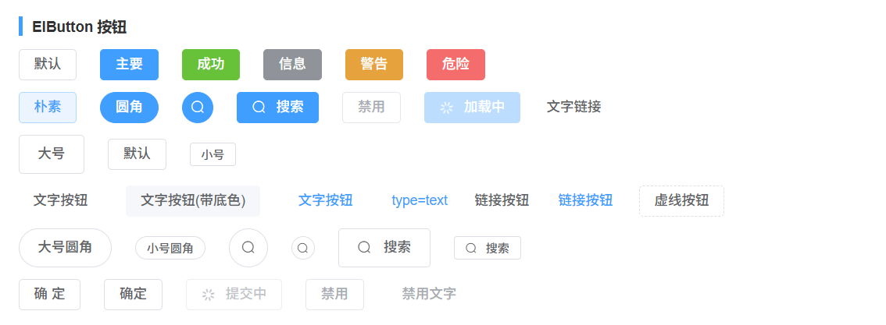
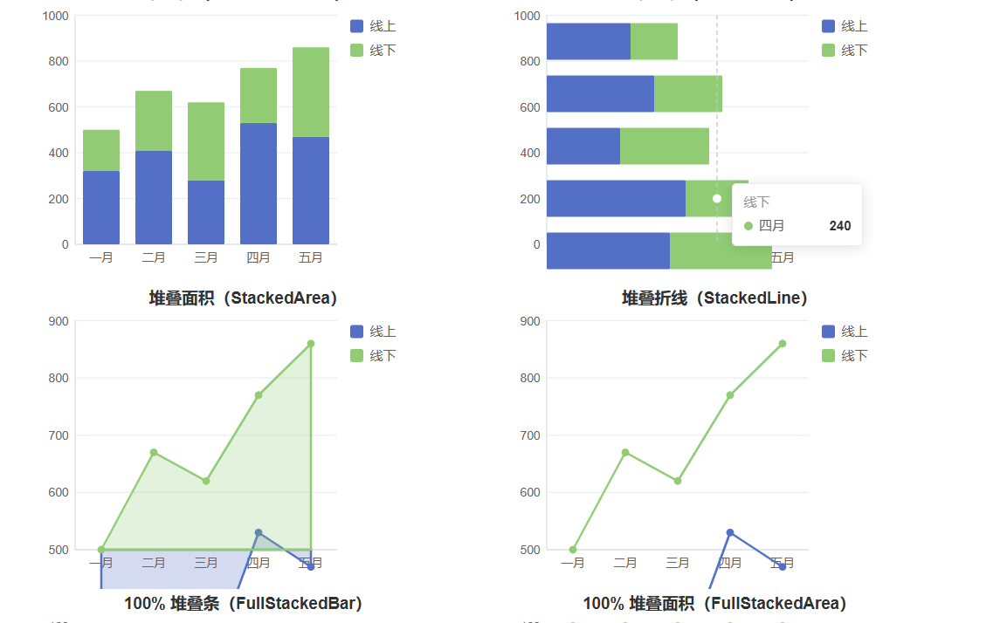
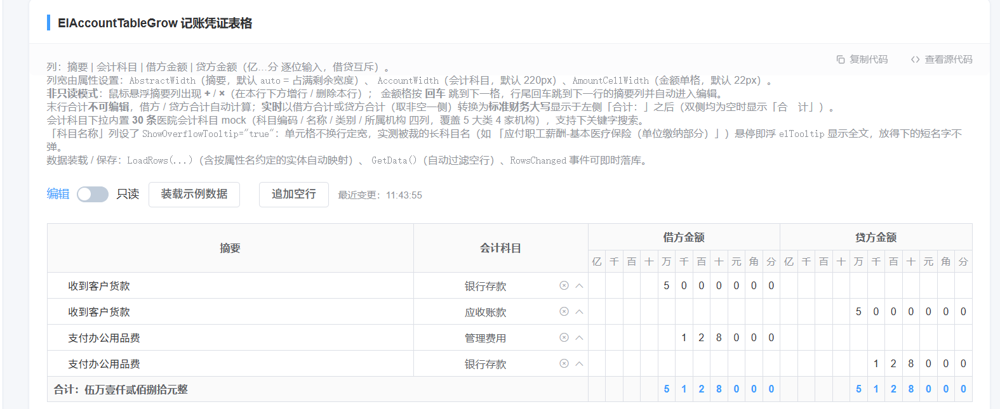
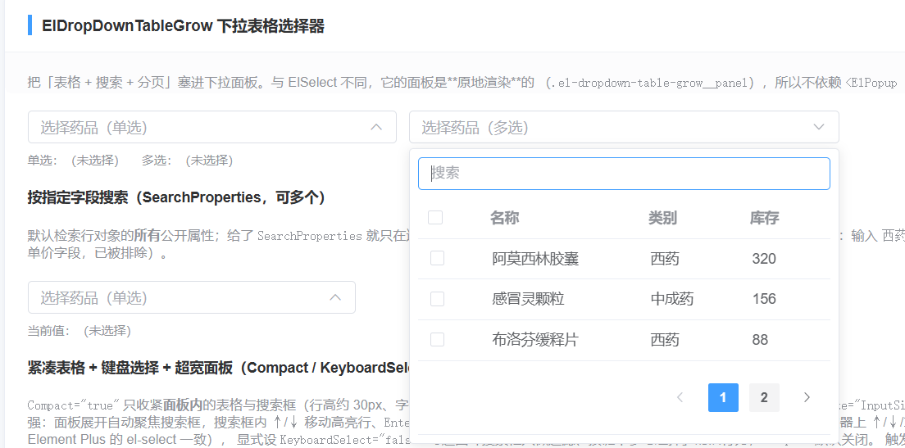

<p align="center">
  <a href="README.md"><strong>English</strong></a> ·
  <a href="README.zh-CN.md"><strong>中文</strong></a>
</p>

# ElementPlus-Blazor

[](LICENSE)
[](#)
[](https://sdhzth.github.io/ElementPlus-Blazor/)

> **🚀 Live demo**: <https://sdhzth.github.io/ElementPlus-Blazor/> — all components running on Blazor WebAssembly, no install needed.

**ElementPlus-Blazor** is an independent Blazor component library aligned with
[Element Plus 2.14](https://element-plus.org/), maintained by **Smart**. It ships a rich set of
Razor components (the `El*` family) and brings the Element Plus look-and-feel to
**Blazor Server**, **Blazor WebAssembly**, and the **Blazor Web App** hosting model.

> The root namespace is `ElementPlus` (formerly `Element`). The NuGet `PackageId`
> stays `Element-Plus`, so static asset paths remain `/_content/Element-Plus/...`.

### NuGet Packages

| Package | Description | Target |
| --- | --- | --- |
| `Element-Plus` | Core component library | `net10.0` / `net11.0` |
| `Element-Plus.X` | Extended / extra components | `net10.0` / `net11.0` |
| `Element-Plus.Markdown` | Markdown rendering support | `net10.0` / `net11.0` |

> **.NET 11 verified**: built and fully tested with the .NET SDK 11.0.100 —
> a `net11.0` target compile and the complete 2,860-test bUnit suite both pass.

### Installation

> **Current release: `0.12.5`** (see [CHANGELOG.md](CHANGELOG.md) for the version history).
> The commands below resolve the latest version automatically; pin it with
> `dotnet add package Element-Plus --version 0.12.5` when a fixed version is required.

```powershell
dotnet add package Element-Plus
# optional extensions / markdown
dotnet add package Element-Plus.X
dotnet add package Element-Plus.Markdown
```

### Getting Started

1. Register the services in `Program.cs` / `Startup.cs`:

   ```csharp
   builder.Services.AddElementPlusServices();
   ```

2. Reference the static assets in your host page (e.g. `App.razor` or `_Host.cshtml`):

   ```html
   <link rel="stylesheet" href="/_content/Element-Plus/css/index.css" />
   <script src="/_content/Element-Plus/js/dom.js"></script>
   ```

3. Use the `El*` components in a Razor file:

   ```razor
   @using ElementPlus

   <ElButton Type="@ButtonType.Primary">Primary</ElButton>
   <ElInput TValue="string" Placeholder="Search" Clearable="true" />
   ```

### Project Structure

```
src/
  Components/        # Core library (Element-Plus)
  X/                # Extended components (Element-Plus.X)
  Markdown/         # Markdown support (Element-Plus.Markdown)
  VSExtension/      # Visual Studio item/project templates (.vsix)
demo/
  Element.Blazor.Demo/  # Example Blazor application (also the admin shell)
templates/
  ElementPlus.Admin/ # `dotnet new` project template (separate from the .vsix)
test/               # Component tests
docs/               # Design & usage documentation
```

## Screenshots

A few screenshots captured from the demo project (the component gallery):

<p align="center">
  
  
</p>
<p align="center">
  
  
</p>

> **Two ways to scaffold the admin shell from Visual Studio:**
>
> 1. **`dotnet new` template** (recommended) — installs the admin starter as a `dotnet new`
>    template. After `dotnet new install` you can pick **"Element-Plus Admin 中台模板 (Blazor
>    WebAssembly)"** directly in the VS 2022 *New Project* dialog.
> 2. **VSIX project template** — `src/VSExtension` bundles the same shell as a native VS
>    project template (`ElementAdminServerRenderProject.zip`); building the VSIX registers it in
>    the *New Project* dialog automatically.

Both produce an **independent Blazor WebAssembly project** that references the published NuGet
packages (`Element-Plus` / `Element-Plus.X` / `Element-Plus.Markdown` `0.12.5`) and renames the
namespace to your project name on instantiation.

### Admin Starter Template (中台模板)

The `demo/` project is **not only a component gallery** — it is also a **ready-to-fork admin
shell**. Fork it and replace the in-memory Mock data with your own API to get a working backend
in minutes. The admin pages live under the **「中台模板」** sidebar group:

| Route | Page | What it demonstrates |
| --- | --- | --- |
| `/login` | 登录页 Login | A **standalone login layout** (`@layout LoginLayout`) decoupled from the main shell. |
| `/dashboard` | 控制台 Dashboard | Stat cards (`ElStatistic`) + recent-data table + todo timeline. |
| `/admin/users` | 用户管理 | List + CRUD via a **service dialog** (`ElDialogGrowService.OpenAsync`). |
| `/admin/roles` | 角色管理 | List + CRUD via an **inline `ElDialog` form** (no service). |
| `/admin/permissions` | 权限管理 | Same pattern, with an enum **dropdown** (菜单 / 按钮 / 接口). |
| `/admin/menus` | 菜单管理 | Same pattern, with a dynamic **parent-menu dropdown** + numeric sort. |

**How the navigation stays consistent:** every sidebar item, tab title and breadcrumb is derived
from the single source of truth `demo/.../Shared/DemoNavigation.cs` (fixed entries + grouped
sections). Add a page → add one `DemoNavEntry` → the menu / tab / breadcrumb all follow.

**How to turn a template page into your real backend:**

1. Inject your `HttpClient` / service into the page (e.g. `UserManage.razor`).
2. Replace the in-memory `List<T>` (e.g. `users`, `roles`, `perms`, `menus`) with calls to your
   API: load in `OnInitializedAsync`, and call `POST/PUT/DELETE` in `AddAsync` / `EditAsync` /
   `DeleteAsync`.
3. Swap the model classes in `demo/.../Models/` (`EmployeeModel`, `RoleModel`,
   `PermissionModel`, `MenuModel`) for your DTOs.

Two CRUD dialog styles are intentionally shown so you can pick one:
- **Service dialog** (`UserManage`): open any component with one line and `await` its return value.
- **Inline dialog** (`RoleManage` / `PermissionManage` / `MenuManage`): a local `ElDialog` whose
  form binds directly to a page field — fully self-contained, easiest to copy into a new page.

#### Scaffold via `dotnet new` (recommended)

Install the template from this repo, then create a project in one step:

```powershell
# 1. install the template (path points at the folder that contains .template.config)
dotnet new install <repo-root>/github-upload/templates/ElementPlus.Admin

# 2. create a new admin project (namespace is auto-renamed to "MyAdmin")
dotnet new elementplus-admin -n MyAdmin -o MyAdmin

# 3. build it (references NuGet Element-Plus 0.12.5, no source checkout needed)
cd MyAdmin
dotnet build -c Release
```

After step 1, the template **also appears in the Visual Studio 2022 *New Project* dialog** —
search for **"Element-Plus Admin"** and it shows up as
**"Element-Plus Admin 中台模板 (Blazor WebAssembly)"**. The generated project:

- Targets `net10.0` Blazor WebAssembly and references the published NuGet packages
  (`Element-Plus` / `Element-Plus.X` / `Element-Plus.Markdown` `0.12.5`) — no local source build
  required.
- Renames the root namespace from the template's `ElementPlus.Blazor.Demo` to your project name
  (e.g. `MyAdmin`) in **both file names and file contents** automatically.
- Ships the same 6 pages (`/login`, `/dashboard`, `/admin/users`, `/admin/roles`,
  `/admin/permissions`, `/admin/menus`), the `MainLayout` / `LoginLayout` shell, the tab
  keep-alive host, and `wwwroot/js/demo-shell.js`.

To uninstall the template later:

```powershell
dotnet new uninstall <repo-root>/github-upload/templates/ElementPlus.Admin
```

##### Build & distribute as a NuGet template package (recommended for teams)

The folder-based `dotnet new install` above keeps a hard link to a local path, which is fragile
for sharing. For team distribution, pack the template into a **NuGet template package** instead:

```powershell
# build the .nupkg (output: templates/ElementPlus.Admin.Template/bin/Release/*.nupkg)
dotnet pack github-upload/templates/ElementPlus.Admin.Template -c Release

# anyone on the team installs it with one command (no repo checkout needed):
dotnet new install Element-Plus.Admin.Template.0.12.5.nupkg
```

> `0.12.5` is the version at the time of writing. Replace it with the current version after a
> release, or omit the version entirely — `dotnet new install Element-Plus.Admin.Template`
> resolves the latest version from the feed. The same applies to the `0.12.5` references
> elsewhere in this document.

Or push the `.nupkg` to an **internal NuGet feed** so teammates can
`dotnet new install Element-Plus.Admin.Template` by package id. A NuGet-installed template is
extracted into the user's template cache (path-independent after install) and shows up in the VS
2022 *New Project* dialog just like the folder install — and it is the more robust of the two.

> The packaging project (`templates/ElementPlus.Admin.Template/ElementPlus.Admin.Template.csproj`)
> packs the real template (`../ElementPlus.Admin`) verbatim into `content/`, so there is a single
> source of truth — edit the template under `templates/ElementPlus.Admin/` and re-pack.

##### For external / remote customers (published to NuGet.org)

Once the package is published, **customers in any region** install it with a single command — no
Git checkout, no local path, no Visual Studio extension required:

```powershell
# installs the admin starter template from NuGet.org (global CDN)
dotnet new install Element-Plus.Admin.Template
```

After that, the template shows up in the **VS 2022 *New Project* dialog** (search
"Element-Plus Admin") on their machine too. The generated project references the public
`Element-Plus` / `Element-Plus.X` / `Element-Plus.Markdown` `0.12.5` packages on NuGet.org, so
restore works automatically anywhere NuGet.org is reachable. (If a customer is behind a network
where NuGet.org is slow, they can instead download the `.nupkg` from the GitHub Releases page and
run `dotnet new install <downloaded-file>.nupkg`.)

#### Scaffold via the VSIX (native VS project template)

The `src/VSExtension` project bundles the same shell as a native Visual Studio project template
(`ProjectTemplates/ElementAdminServerRenderProject.zip`, template references pinned to
`Element-Plus` 0.12.5).
Building the VSIX registers it under **C# → Blazor WebAssembly** in the *New Project* dialog. The
`source.extension.vsixmanifest` `InstallationTarget` is set to `[17.0,18.0)` so it shows in
**VS 2022** (the old 2020-era manifest targeted `[16.0,17.0)` and was invisible in VS 2022).

### Build from Source

```powershell
dotnet build ElementPlus-Blazor.slnx -c Release
```

### Documentation

- Component & design notes: [`docs/`](docs)
- Release history: [`CHANGELOG.md`](CHANGELOG.md)
- Contribution guide: [`CONTRIBUTING.md`](CONTRIBUTING.md)

### License

Released under the [MIT License](LICENSE).
