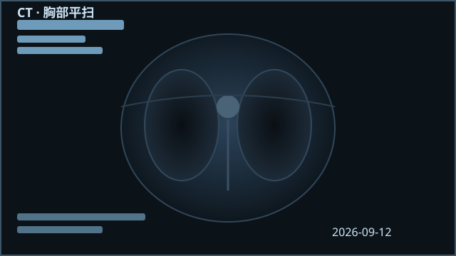
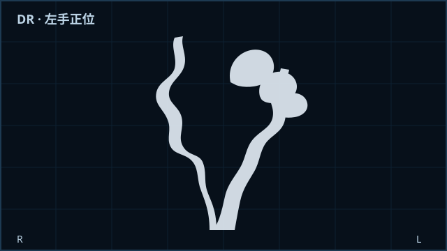
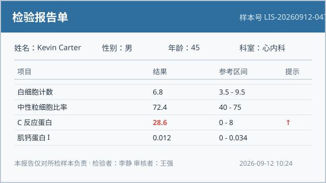
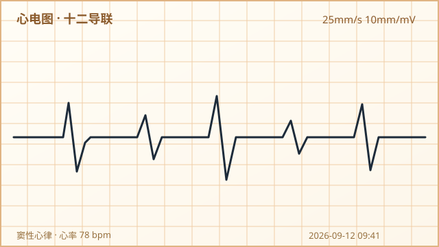

<p align="center">
  <a href="README.md"><strong>English</strong></a> ·
  <a href="README.zh-CN.md"><strong>中文</strong></a>
</p>

# ElementPlus-Blazor

[](LICENSE)
[](#)

**ElementPlus-Blazor** 是一套独立的 Blazor 组件库，对齐 [Element Plus 2.14](https://element-plus.org/)，
由 **Smart** 维护。它提供丰富的 Razor 组件（`El*` 系列），在 **Blazor Server**、
**Blazor WebAssembly** 以及 **Blazor Web App** 托管模型中还原 Element Plus 的视觉风格与交互体验。

> 根命名空间为 `ElementPlus`（原 `Element`）。NuGet 包名 `PackageId` 仍为 `Element-Plus`，
> 因此静态资源路径保持为 `/_content/Element-Plus/...`。

### NuGet 包

| 包名 | 说明 | 目标框架 |
| --- | --- | --- |
| `Element-Plus` | 核心组件库 | `net10.0` |
| `Element-Plus.X` | 扩展 / 额外组件 | `net10.0` |
| `Element-Plus.Markdown` | Markdown 渲染支持 | `net10.0` |

### 安装

```powershell
dotnet add package Element-Plus
# 可选扩展 / Markdown
dotnet add package Element-Plus.X
dotnet add package Element-Plus.Markdown
```

### 快速开始

1. 在 `Program.cs` / `Startup.cs` 中注册服务：

   ```csharp
   builder.Services.AddElementPlusServices();
   ```

2. 在宿主页面（如 `App.razor` 或 `_Host.cshtml`）引用静态资源：

   ```html
   <link rel="stylesheet" href="/_content/Element-Plus/css/index.css" />
   <script src="/_content/Element-Plus/js/dom.js"></script>
   ```

3. 在 Razor 文件中使用 `El*` 组件：

   ```razor
   @using ElementPlus

   <ElButton Type="@ButtonType.Primary">主要按钮</ElButton>
   <ElInput TValue="string" Placeholder="搜索" Clearable="true" />
   ```

### 项目结构

```
src/
  Components/           # 核心库（Element-Plus）
  X/                   # 扩展组件（Element-Plus.X）
  Markdown/            # Markdown 支持（Element-Plus.Markdown）
  VSExtension/         # Visual Studio 项/项目模板
demo/
  Element.Blazor.Demo/ # 示例 Blazor 应用
test/                  # 组件测试
docs/                  # 设计与使用文档
```

## 演示图

示例项目自带一组**离线可用**的 SVG 演示图（位于 `demo/Element.Blazor.Demo/wwwroot/images/`），
贯穿组件演示（如 `LayoutDemo` 页面），展示组件库在医疗场景下的渲染效果——
CT、X 光、检验报告、心电图，无需联网依赖：

<p align="center">
  
  
  
  
</p>

### 从源码构建

```powershell
dotnet build ElementPlus-Blazor.slnx -c Release
```

### 文档

- 组件与设计说明：[`docs/`](docs)
- 版本历史：[`CHANGELOG.md`](CHANGELOG.md)
- 贡献指南：[`CONTRIBUTING.md`](CONTRIBUTING.md)

### 许可证

基于 [MIT 许可证](LICENSE) 发布。
