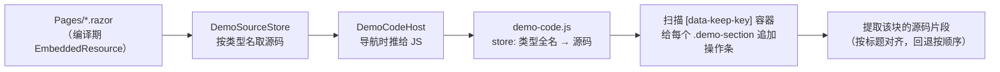

# 演示站：示例块「复制代码 / 查看源代码」操作条

对齐 Element Plus 官方文档（如 <https://element-plus.org/zh-CN/component/border>）：
**每个示例块右下角都有一排小按钮**——复制该示例的代码、查看该示例的源码。
本演示中心现在每个 `<div class="demo-section">` 底部都有这两个按钮。

## 效果

| 按钮 | 行为 |
| --- | --- |
| `复制代码` | 把**本段示例**的 Razor 代码写入剪贴板；成功后按钮自身变「✓ 已复制」，1.4s 复原；失败（HTTP + 局域网 IP 等非安全上下文且 `execCommand` 也不可用）弹出提示让用户手动复制 |
| `查看源代码` | **在示例块内就地展开**代码面板（不是弹窗，块会被撑开、代码铺在块底部，与官方文档一致）：顶部一条工具条——左侧 `本段示例` / `整页源码` 分段切换，右侧 `复制` 与 `收起` 两个图标按钮；代码左侧带**折叠箭头**可逐层收起/展开子行；展开时按钮变「收起代码」并高亮，`Esc` 或点工具条的 `<>` 收起 |

操作条视觉：贴在示例块底部、横向铺满（负外边距按容器实际 `padding` 计算，底部圆角随容器），
平时淡灰（`opacity .82`），容器悬停或键盘聚焦时恢复；按钮悬停变主色浅底。
展开代码面板时操作条让出圆角与底部边距，由面板承接块的底部圆角，两者无缝拼成一块。

### 代码面板（就地展开）

| 部件 | 说明 |
| --- | --- |
| 分段切换 | `本段示例`（该块自身的代码）/ `整页源码`（整份 `.razor`）；**首次点到才渲染** |
| 图标 `复制` | 复制当前页签的内容，成功后图标变对勾 |
| 图标 `<>` | 收起代码面板 |
| 折叠箭头 | 每行左侧 `˅`，点一下收起来缩进更深的子行（箭头转 `˃`、行尾显示 `⋯`）；再点恢复。支持嵌套折叠 |
| 文件名 | 工具条中间显示 `BorderDemo.razor · 边框样式（border-style）` |

**性能**：486 个示例块不可能一次性把源码铺进 DOM——面板外壳（工具条 + 空代码区）在注入时就建好，
但**代码首次展开才逐行渲染**，且两个页签各自懒渲染。折叠状态按「已折叠行号集合」重算可见行，
嵌套折叠只是区间包含、取并集即可，展开外层不会误伤内层状态。

## 实现（为什么不是逐页改）

示例块在 **89 个页面里手写了 486 个**，逐页改既容易改坏、也要一直与页面内容保持同步，
所以走「浏览器侧增强」：**页面零改动**，由三个部件协作。



### 1）源码怎么进浏览器

Blazor WASM 跑在浏览器里读不到磁盘上的 `.razor`，所以在编译期把 demo 页源码打进程序集：

```xml
<ItemGroup>
  <EmbeddedResource Include="Pages\**\*.razor" LogicalName="DemoSource.%(Filename)%(Extension)" />
  <EmbeddedResource Include="Components\**\*.razor" LogicalName="DemoSource.%(Filename)%(Extension)" />
</ItemGroup>
```

- `Shared/DemoSourceStore.cs`：类型全名 → 文件名（`Element.Blazor.Demo.Pages.BorderDemo` → `BorderDemo.razor`）
  → 读内嵌资源（带缓存）。取不到就返回 `null`，只退化为「没有操作条」，绝不影响页面本身。
- `Components/DemoCodeHost.razor`：挂在 `App.razor` 的 `<Found>` 里（紧随 `KeepAliveRouteView`），
  导航时把 `(类型全名, 文件名, 源码)` 推给 JS；同一页重复导航会被跳过。

### 2）为什么用 `data-keep-key` 认页面

`KeepAliveRouteView` 给每个缓存页容器打了 `data-keep-key="页面类型全名|路由参数"`，
所以 JS 能直接从 DOM 反推当前页面用的是哪份源码，**不需要额外维护路由表**；
同一页面带不同路由参数打开多个标签也能各取所需（源码按类型全名共享）。

### 3）时序问题：源码可能比 DOM 先到

keep-alive 是「两阶段挂载」（先占位、下一帧才真正挂载页面组件），
`OnParametersSetAsync` 里的源码下发常常早于页面 DOM 出现。
所以 JS 不做一次性注入，而是：**MutationObserver（`childList + subtree`，180ms 去抖）** 持续扫描，
`data-keep-key` 容器里只要有**没有操作条**的 `.demo-section` 就补上。
插入操作条本身会再触发一次回调，但那一轮没有可改的节点，扫描自然收敛。

### 4）片段怎么切

- 按 `<div class="demo-section">` 起始位置 + `<div>` 嵌套深度配对找收尾（自闭合 `<div/>` 不加深）。
- 只认「标签起始位置」的匹配（前置非空白字符必须是行首或 `>`），
  避免命中 C# 字符串里手写的 `<div class="demo-section">`。
- 去公共缩进、去首尾空行，复制出来的代码贴左。
- 与 DOM 里的块对号：**先按块内首个标题（h1~h6）文本精确匹配**（486 个块的标题在每个页面内唯一），
  标题缺失或重名时退回按出现顺序。
- `TimelineDemo` 这类用 `<h4>` 而不是 `<h3>` 的页面同样命中。

### 5）折叠区间怎么算

按**缩进**算，不做标签配对（Razor 里 `@if`/`@foreach` 的标签是配不平的，缩进法天然正确且不会算错）：

- 某行的下一个非空行缩进更深 → 该行可折叠；折叠范围一直到「最后一个缩进仍更深的行」。
- 纯缩进法**不可能产生交叉区间**，嵌套折叠只是包含关系；折叠集合取并集即可算出隐藏行，
  展开外层不会误伤内层状态。
- 收起时该行箭头转 `˃` 并在行尾显示 `⋯`，`aria-expanded` 同步。

全量校验（`ce_build/test_demo_code_folds.cjs`）：486 个示例块共 **1702 个折叠区间**（1216 个嵌套），
区间合法性 / 缩进单调 / 极大性 / 不交叉 / 收起至少藏一行，**10218 条断言全过**。

## 已知边界

- 高亮是**轻量单遍正则**着色（注释 / `@` 指令 / 标签名 / 属性名 / 字符串），不是语法分析器；
  Razor 里复杂的内联 C# 只保证不着错、不破坏文本。
- 「整页源码」是**编辑期源码**（含页面顶部的 `@page` 等；是否含 `@code` 取决于该页本身，如 `/border` 是纯标记页、没有 `@code`），
  不是反编译结果；页面运行时的动态数据不在其中。已实测「整页源码」与磁盘上的 `.razor` **逐字符一致**。
- 复制到 Windows 剪贴板后换行是 `CRLF`（系统剪贴板行为，与官方文档站一致）。
- 页面里通过 `@foreach` 动态生成的重复块仍只有一个源码片段（源码里也只有一个）。
  当前 89 个页面均无此情况（486/486 一一对应，已由 `ce_build/test_demo_code_parse.cjs` 覆盖）。
- `<div class="demo-section">` 之外的容器（如 `/all-components` 画廊卡片）不注入操作条。

## 回归

| 用例 | 说明 |
| --- | --- |
| `ce_build/test_demo_code_parse.cjs`（node） | 对全部 95 个 demo `.razor` 跑切分：`486/486` 块、0 处数量不符、0 块缺标题、每页标题唯一、高亮标签成对 |
| `ce_build/test_demo_code_folds.cjs`（node） | 折叠区间全量校验：1702 个区间 / 1216 个嵌套，合法性 + 缩进单调 + 极大性 + 不交叉 + 收起至少藏一行，**10218 条断言全过** |
| `ce_build/probe_demo_code_app.cjs`（Playwright + msedge，打真实站） | 端到端：操作条数量与文案 / 铺满块宽 / 默认懒渲染 / **点按钮就地展开**（无弹层、块被撑开 `157→357px`、面板紧接操作条下方）/ 圆角交接 / 两页签 + 文件名 + 两个图标按钮 / 逐行渲染 + 高亮 + 折叠箭头 / 折叠收起再恢复 / 面板内复制 == 源码且行数一致 / **「整页源码」与磁盘 `.razor` 逐字符一致** / Esc 收起并复位 / h4 标题页 / keep-alive 切回不重复不丢失 / 无 JS 异常 |
| `ce_build/test_demo_code_browser.cjs`（Playwright + msedge，本地 harness） | 离线预检：注入数量 / 文案 / 负外边距与实测宽度 / 剪贴板逐字符一致 / 就地展开与折叠 / **源码先到、DOM 后到**（MutationObserver 路径）也能补上操作条 |

改动文件：

- `demo/Element.Blazor.Demo/wwwroot/js/demo-code.js`（新增，操作条 + 就地展开的代码面板 + 折叠）
- `demo/Element.Blazor.Demo/wwwroot/css/app.css`（新增 `.demo-code-*` / `.dcl*` / `.dc-*` 样式；**demo 侧样式，不进组件库 `index.css`**）
- `demo/Element.Blazor.Demo/wwwroot/index.html`（引入脚本）
- `demo/Element.Blazor.Demo/Element.Blazor.Demo.csproj`（内嵌页源码）
- `demo/Element.Blazor.Demo/Shared/DemoSourceStore.cs`、`Components/DemoCodeHost.razor`（新增）
- `demo/Element.Blazor.Demo/App.razor`（挂载 `DemoCodeHost`）

> 改 `wwwroot` 下的 `js` / `css` **不需要重新编译**——`dotnet run` 的 DevServer 直接从项目 `wwwroot` 提供静态文件，
> 浏览器 `CTRL+F5` 即可看到改动。
